<p align="center">
  
</p>

<p align="center">
  
  
  
  
  
</p>

> **TL;DR.** My **26 GNU Radio flowgraphs** from IIT Bombay's communications lab (EE340), taking a signal from a single sine wave to a complete digital radio link. The labs cover:
> - FM modulation, and how non-linear amplifiers distort signals
> - pulse shaping, matched filtering, then BPSK, QPSK and 8-PSK
> - a multipath channel and the equaliser that undoes it
> - carrier synchronisation with a Costas loop
>
> **Everything plotted here comes from actually running these flowgraphs** in GNU Radio 3.10 (headless, see [how](#how-this-repo-was-made)). The headline result: a paragraph of text goes through each digital link and comes back with **zero bit errors**, including through a two-path echo channel once the equaliser is switched on.

---

## Text in → radio → text out

Each digital lab sends the same 1,421-character paragraph through the flowgraph: bits → symbols → pulse shaping → 100 kHz carrier → noise → receiver → bits. The received file is then compared with the original, bit by bit:

<p align="center">
  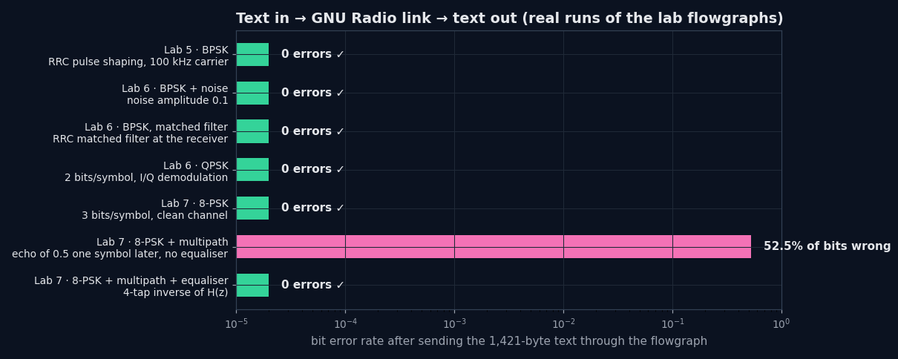
</p>

The one red bar is the point of Lab 7. An echo arriving one symbol late smears every symbol into the next (inter-symbol interference), so the text comes out as garbage. A 4-tap equaliser that inverts the channel brings it back perfectly:

<p align="center">
  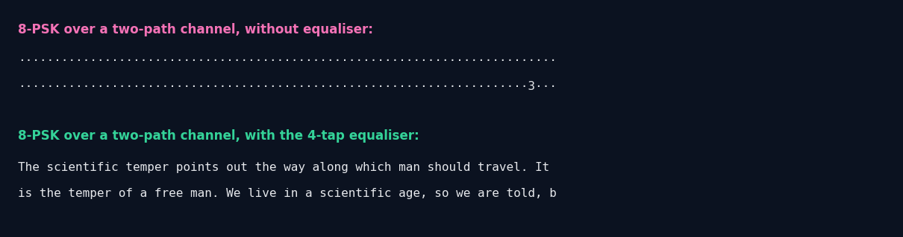
</p>

---

## The labs

| Lab | Topic | What I built | Result shown below |
|---|---|---|---|
| 1 | GNU Radio basics | 5-band audio equaliser, notch filter, VCO tone generator, mixing two audio tracks | flowgraph |
| 3 | FM | FM modulator (Δf = 75 kHz) and a quadrature demodulator, with noise and pre-/de-emphasis | spectrum + recovered message |
| 4 | Non-linearity | diode (exp) and amplifier (tanh) models driven by a band-limited signal | harmonics appearing |
| 5 | BPSK + pulse shaping | root-raised-cosine (RRC) pulse shaping, 100 kHz carrier, full text link | 0 bit errors |
| 6 | Matched filter + QPSK | RRC matched filter, QPSK modulator / I-Q demodulator / 2×4 decoder | eye diagrams, 0 bit errors |
| 7 | Multipath + equalisation | 8-PSK, channel H(z) = 1 + 0.5z⁻¹, 4-tap feed-forward equaliser, adaptive equaliser | constellation cleaning up |
| 8 | Carrier synchronisation | Costas loop for QPSK and M-PSK | loop locking animation |

### Lab 1 · Getting started

A 5-band graphic equaliser: five band-pass filters, each with its own gain slider, summed back together.

<p align="center">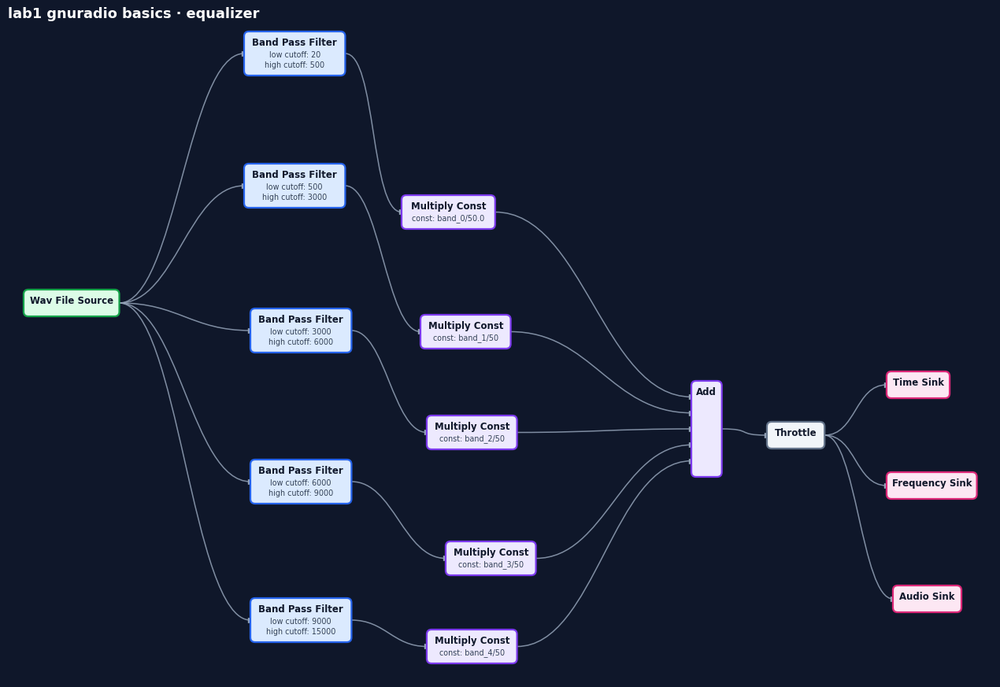</p>

### Lab 3 · FM modulation and demodulation

Two tones (1.1 kHz and 11 kHz) frequency-modulate a 100 kHz carrier with 75 kHz deviation, the same deviation as broadcast FM. The receiver is a **quadrature demodulator**: multiply the signal by a one-sample-delayed conjugate of itself and take the angle. That gives the phase change per sample, which is the instantaneous frequency, which is the message.

<p align="center">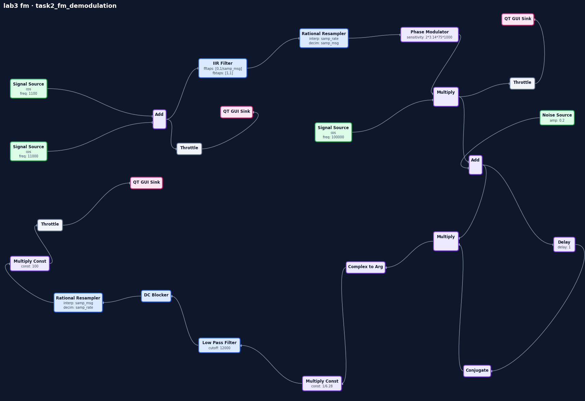</p>
<p align="center"></p>

### Lab 4 · Non-linearity

Real amplifiers saturate. Modelling one as tanh() and driving it harder makes the 340–520 kHz signal leak into its **3rd and 5th harmonic bands**, about 50 dB higher than with gentle drive. That is why a transmitter's power amplifier needs filtering after it.

<p align="center">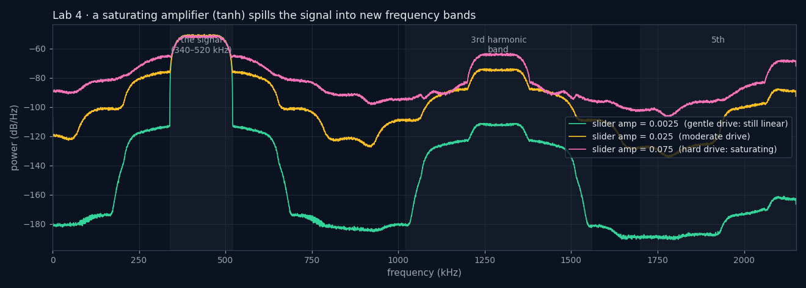</p>

### Labs 5 & 6 · Pulse shaping, matched filtering, QPSK

Sharp rectangular pulses waste bandwidth, so every symbol is shaped with a **root-raised-cosine (RRC)** pulse. The roll-off α sets the trade-off: the bandwidth is (1 + α) × symbol rate / 2.

<p align="center">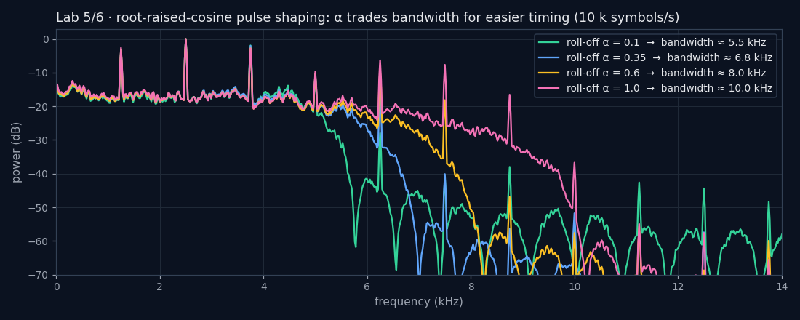</p>

The receiver uses the **same RRC filter again (the matched filter)**. The two together form a raised-cosine pulse with no inter-symbol interference at the sampling instants, and this choice maximises the SNR. The eye diagram shows it: with no noise the eye is wide open, and noise gradually closes it.

<p align="center">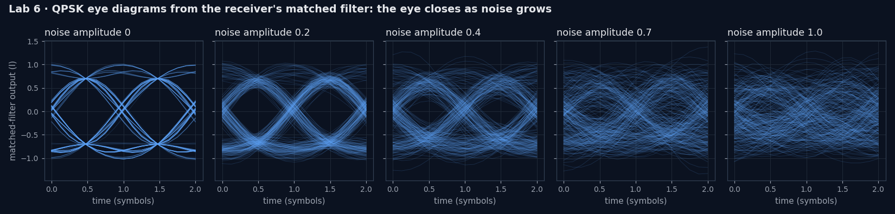</p>

The complete QPSK link: text → 2-bit chunks → QPSK symbols → RRC → I/Q up-conversion to 100 kHz → noise → I/Q down-conversion → matched filter → threshold → 2×4 decoder → text.

<p align="center">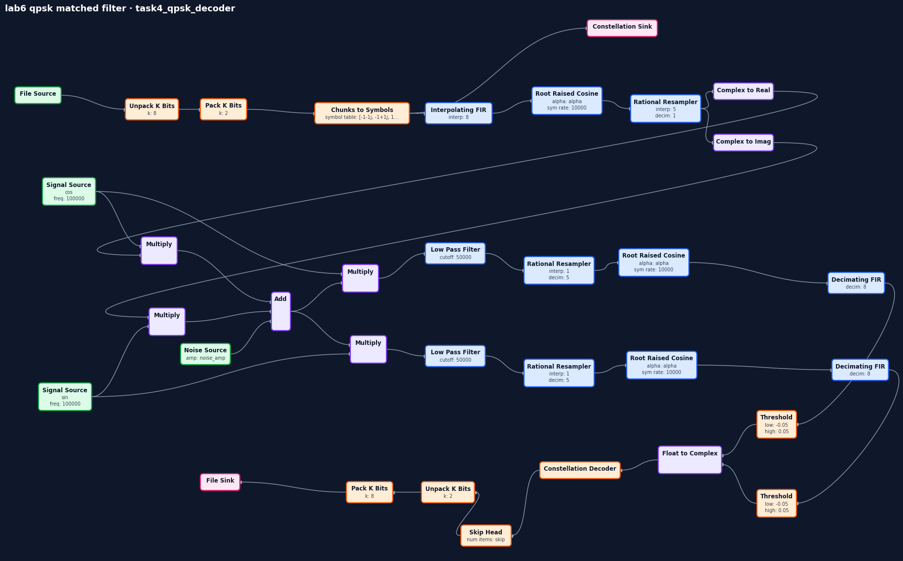</p>

### Lab 7 · Multipath and equalisation

The channel adds an echo of half the strength one symbol later: **H(z) = 1 + 0.5z⁻¹**. Its inverse is an infinite series, 1/H(z) = 1 − 0.5z⁻¹ + 0.25z⁻² − 0.125z⁻³ + …, and the equaliser keeps the first four taps. The animation steps the taps from 0 to that exact inverse. Each frame is a separate GNU Radio run of my flowgraph, and the points come from its receiver's constellation sink:

<p align="center">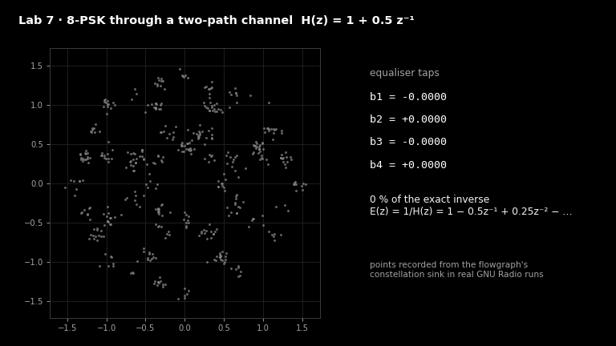</p>

<details>
<summary><b>The full Lab 7 flowgraph (71 blocks, 85 connections)</b></summary>
<p align="center">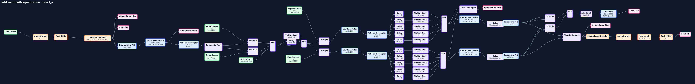</p>
</details>

### Lab 8 · Carrier synchronisation (Costas loop)

A receiver's oscillator is never exactly at the transmitter's frequency, so the constellation **spins**. A **Costas loop** measures the phase error from the symbols themselves, filters it, and steers its own oscillator until the spin stops. My lab flowgraphs, with a Viterbi–Viterbi M-PSK variant on the right:

<p align="center"> 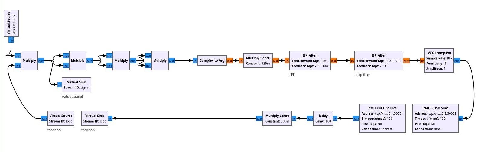</p>

The same idea, run in GNU Radio ([`tools/costas_lock_demo.py`](tools/costas_lock_demo.py)): its frequency estimate converges to the true offset and the ring collapses to four points.

<p align="center">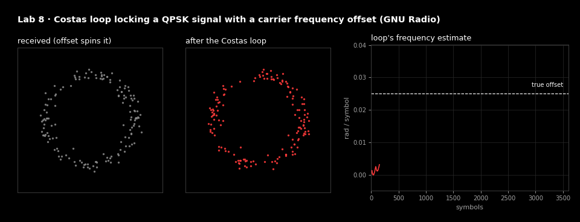</p>

---

## How this repo was made

These are GUI flowgraphs: every result was a live scope window during the lab. To get real numbers and pictures out of them:

- [`tools/run_headless.py`](tools/run_headless.py) rewrites a `.grc` file before compiling it with GNU Radio's `grcc`:
  - every scope (time, frequency, constellation, eye) becomes a vector sink that records what it would have displayed;
  - every slider becomes a fixed value, which can be overridden with `--set` (that is how the sweeps were made);
  - file paths point at [`data/`](data).

  The flowgraph then runs headless and everything is saved.
- [`tools/grc_render.py`](tools/grc_render.py) draws each `.grc` as the block diagrams shown above, using the block positions, parameters and wires stored in the file.
- [`docs/make_figures.py`](docs/make_figures.py) turns the recorded data into the figures and animations.

```bash
# GNU Radio 3.10 environment (e.g. radioconda, or: micromamba create -n gr -c conda-forge gnuradio=3.10)
python tools/run_headless.py labs/lab6_qpsk_matched_filter/task4_qpsk_decoder.grc runs/lab6_task4.npz --inputs data
python tools/run_headless.py labs/lab7_multipath_equalization/task1_e.grc runs/sweeps/eq_1.npz --inputs data \
       --set b1=-0.5 --set b2=0.25 --set b3=-0.125 --set b4=0.0625
python tools/costas_lock_demo.py runs/costas.npz
COMMS_RUNS=runs python docs/make_figures.py
```

---

## Repository

```
labs/          my flowgraphs (.grc) and the Python GNU Radio generated from them, one folder per lab
data/          inputs: the text that is transmitted (Original_Text.txt) and the Lab 4 test signal (Input.bin)
tools/         headless runner, flowgraph renderer, Costas loop demo
docs/          figures, animations, the script that makes them, and a block diagram of every flowgraph (docs/flowgraphs/)
```

<details open>
<summary><b>What every file does</b></summary>

| Folder / file | What it is |
|---|---|
| **`labs/lab1_gnuradio_basics/`** | `equalizer` (5-band audio EQ), `noise_notch_filter` (band-reject + low-pass on noisy audio), `vco_tone` (tones from a VCO), `voice_over_karaoke` (mixing two audio tracks with resampling) |
| **`labs/lab3_fm/`** | `task1_fm_modulation`, `task2_fm_demodulation` (quadrature demodulator), `task3_fm_noise` (FM with noise, pre-emphasis and de-emphasis) |
| **`labs/lab4_nonlinearity/`** | `task1a` diode exp() model, `task1b` tanh() amplifier, `task2a` tanh() with an added 48 kHz interferer |
| **`labs/lab5_bpsk_pulse_shaping/`** | `lab5_1` RRC pulse shaping, `lab5_2` up-conversion, `lab5_3` and `Q3` complete BPSK text links; `received_text_Q3.txt` is the text decoded during the lab |
| **`labs/lab6_qpsk_matched_filter/`** | `q1` BPSK with noise, `task1` eye diagram, `task2` matched filter, `task3` QPSK, `task4` QPSK with constellation decoder; `received_text_*.txt` decoded during the lab |
| **`labs/lab7_multipath_equalization/`** | `task1a` 8-PSK, `task1b` + multipath, `task1c`/`task1d` + manual equaliser with error monitor, `task1_e` complete text link, `task2`/`lab7_task2` adaptive (CMA/LMS) linear equaliser |
| **`labs/lab8_carrier_sync/`** | screenshots of the Costas loop flowgraphs for QPSK and M-PSK |
| `tools/run_headless.py` | runs any of the flowgraphs without a GUI and records every scope |
| `tools/grc_render.py` | `.grc` → block-diagram PNG |
| `tools/costas_lock_demo.py` | Costas loop locking a QPSK signal with a frequency offset |
| `docs/make_figures.py` | all README figures and animations, from the recorded runs |

</details>

> [!NOTE]
> The department's lab manuals and exam papers are not included; the table above summarises each lab's tasks. The Lab 1 audio clips are not included either (some are commercial songs). Lab 2 (AM) and the AM hardware lab are not here because their files were not kept.

---

## Acknowledgements

EE340 Communications Lab, Wadhwani Electronics Lab, Department of Electrical Engineering, IIT Bombay (Autumn 2025). Built with [GNU Radio](https://www.gnuradio.org/).
