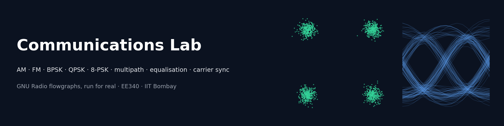
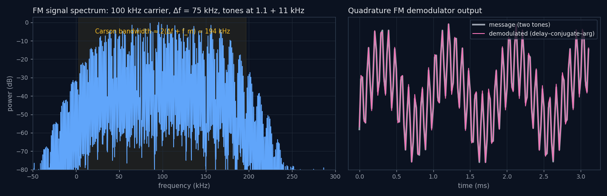
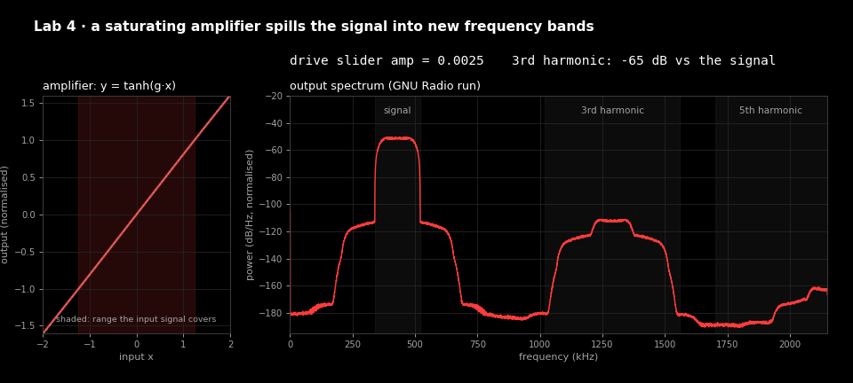
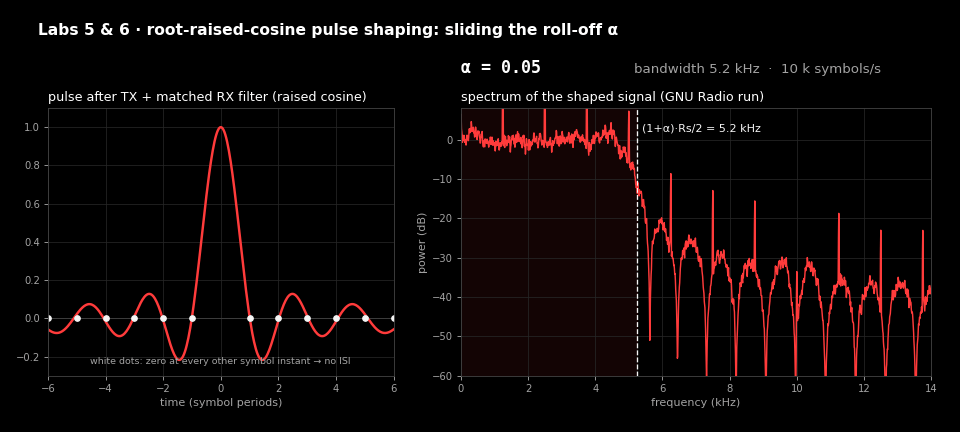
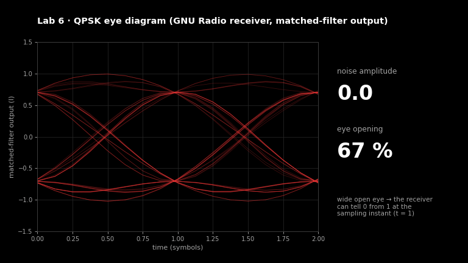
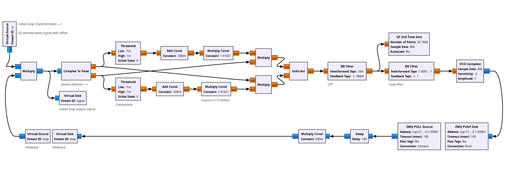
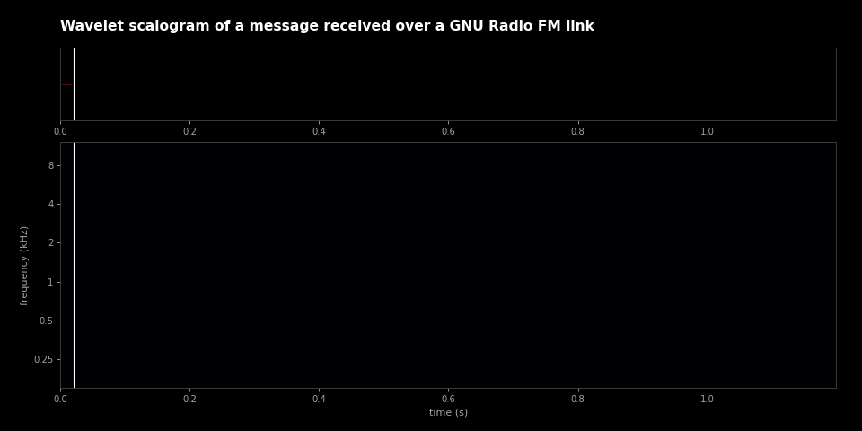
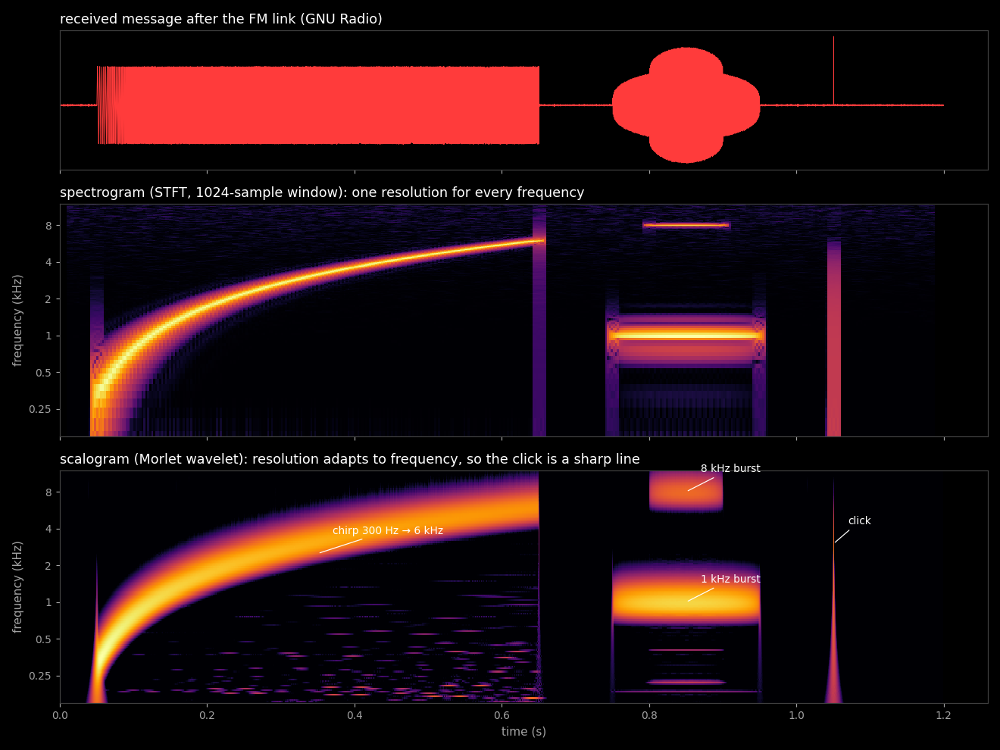

<p align="center">
  
</p>

<p align="center">
  
  
  
  
  
</p>

> **TL;DR.** My **26 GNU Radio flowgraphs** from IIT Bombay's communications lab (EE340). They take a signal from a single sine wave to a complete digital radio link:
> - FM, and what non-linear amplifiers do to signals
> - pulse shaping, matched filtering, BPSK, QPSK and 8-PSK
> - a multipath channel with the equaliser that undoes it
> - carrier synchronisation with a Costas loop
> - a wavelet time–frequency analysis of an FM link
>
> **Every plot and animation here comes from actually running the flowgraphs in GNU Radio 3.10.** A paragraph of text sent through each digital link (BPSK, QPSK, 8-PSK) comes back with **zero bit errors**.

---

## The labs

| Lab | Topic | What I built |
|---|---|---|
| 1 | GNU Radio basics | 5-band audio equaliser, notch filter, VCO tone generator, mixing two audio tracks |
| 3 | FM | FM modulator (Δf = 75 kHz) and quadrature demodulator, with noise and pre-/de-emphasis |
| 4 | Non-linearity | diode (exp) and amplifier (tanh) models driven by a band-limited signal |
| 5 | BPSK + pulse shaping | root-raised-cosine (RRC) pulse shaping, carrier up-conversion, complete text link |
| 6 | Matched filter + QPSK | RRC matched filter, QPSK modulator, I/Q demodulator, 2×4 decoder |
| 7 | Multipath + equalisation | 8-PSK, channel H(z) = 1 + 0.5z⁻¹, 4-tap feed-forward equaliser, adaptive (CMA) equaliser |
| 8 | Carrier synchronisation | Costas loops for QPSK and M-PSK |
| extra | Time–frequency analysis | FM link carrying a chirp, tone bursts and a click; spectrogram vs wavelet scalogram |

### Lab 3 · FM modulation and demodulation

Two tones (1.1 kHz and 11 kHz) frequency-modulate a 100 kHz carrier with 75 kHz deviation, the same deviation as broadcast FM. The receiver is a **quadrature demodulator**: multiply the signal by a one-sample-delayed conjugate of itself and take the angle. That gives the phase change per sample, which is the instantaneous frequency, which is the message.

<p align="center"></p>

### Lab 4 · Non-linearity

Real amplifiers saturate. Here the amplifier is modelled as tanh() and its drive slider is turned up step by step, with one GNU Radio run per step. As the signal starts to reach the flat part of the curve (left), the 340–520 kHz signal leaks into its **3rd and 5th harmonic bands** (right). The 3rd-harmonic band rises by about 50 dB. That is why a transmitter's power amplifier needs filtering after it, or must be backed off from saturation.

<p align="center"></p>

### Labs 5 & 6 · Pulse shaping, matched filtering, QPSK

Sharp rectangular pulses waste bandwidth, so every symbol is shaped with a **root-raised-cosine (RRC)** pulse. The roll-off α is the trade-off:
- a small α gives a narrow spectrum, bandwidth = (1 + α) × symbol rate / 2, but a long pulse with large ripples, so timing errors hurt more;
- a large α gives a short, well-behaved pulse but more bandwidth.

The animation slides α from 0.05 to 1, with one GNU Radio run per value:

<p align="center"></p>

The receiver applies **the same RRC filter again: the matched filter**. The two together form a raised-cosine pulse with no inter-symbol interference at the sampling instants, and this choice maximises the SNR. The eye diagram shows how well the receiver can separate symbols. It is wide open with no noise and closes as the noise grows. Each step below is a separate GNU Radio run of my QPSK flowgraph. At the default noise level, the BPSK and QPSK links deliver the whole text file with zero bit errors.

<p align="center"></p>

### Lab 7 · Multipath and equalisation

The channel adds an echo of half the strength one symbol later: **H(z) = 1 + 0.5z⁻¹**. Its inverse is an infinite series, 1/H(z) = 1 − 0.5z⁻¹ + 0.25z⁻² − 0.125z⁻³ + …, and the equaliser keeps the first four taps. The animation steps the taps from 0 to that exact inverse. Each frame is a separate GNU Radio run, and the points come from the receiver's constellation sink. Without the equaliser, 52% of the received text's bits are wrong. With the four taps, the text comes back with zero bit errors.

<p align="center"></p>

### Lab 8 · Carrier synchronisation (Costas loop)

A receiver's oscillator is never exactly at the transmitter's frequency, so the constellation **spins**. A **Costas loop** measures the phase error from the symbols themselves, filters it, and steers its own oscillator until the spin stops. The Lab 8 flowgraphs in GNU Radio Companion: the QPSK Costas loop (left) and an M-PSK version that estimates the phase with the Viterbi–Viterbi M-th-power method (right):

<p align="center"> </p>

The same idea, run in GNU Radio ([`tools/costas_lock_demo.py`](tools/costas_lock_demo.py)): the loop's frequency estimate converges to the true offset and the spinning ring collapses to four points.

<p align="center"></p>

### Extra · Wavelet time–frequency analysis of an FM link

A message that changes over time goes through a GNU Radio FM link: a chirp sweeping from 300 Hz to 6 kHz, two overlapping tone bursts and a 0.3 ms click. The received message is then viewed in time and frequency at once ([problem statement and solution](labs/extra_wavelet_time_frequency)).

A **spectrogram** uses one 21 ms window at every frequency. That suits steady tones, but the click smears across the whole window. A **Morlet wavelet scalogram** uses short wavelets at high frequency and long ones at low frequency, so its resolution adapts to the signal: the click becomes a sharp vertical line and the chirp a clean rising curve.

<p align="center"></p>

<details>
<summary><b>Spectrogram vs scalogram, side by side</b></summary>
<p align="center"></p>
</details>

---

## How this repo was made

These are GUI flowgraphs: during the lab every result was a live scope window. To get real data out of them, [`tools/run_headless.py`](tools/run_headless.py) rewrites each `.grc` file before compiling it with GNU Radio's `grcc`:
- every scope (time, frequency, constellation, eye) becomes a recorder;
- every slider becomes a fixed value that can be overridden with `--set` (that is how the sweeps were made);
- file paths point at [`data/`](data).

[`docs/make_figures.py`](docs/make_figures.py) turns the recordings into the figures and animations.

```bash
# GNU Radio 3.10 environment (e.g. radioconda, or: micromamba create -n gr -c conda-forge gnuradio=3.10)
python tools/run_headless.py labs/lab6_qpsk_matched_filter/task4_qpsk_decoder.grc runs/lab6_task4.npz --inputs data
python tools/run_headless.py labs/lab7_multipath_equalization/task1_e.grc runs/sweeps/eq_1.npz --inputs data \
       --set b1=-0.5 --set b2=0.25 --set b3=-0.125 --set b4=0.0625
python tools/costas_lock_demo.py runs/costas.npz
python labs/extra_wavelet_time_frequency/fm_wavelet_flowgraph.py runs/fm_wavelet.npz
COMMS_RUNS=runs python docs/make_figures.py
```

---

## Repository

```
labs/          my flowgraphs (.grc) and the Python GNU Radio generated from them, one folder per lab, plus the extra wavelet task
data/          inputs: the transmitted text (Original_Text.txt) and the Lab 4 test signal (Input.bin)
tools/         headless runner and the Costas loop demo
docs/          figures, animations and the script that makes them
```

<details open>
<summary><b>What every file does</b></summary>

| Folder / file | What it is |
|---|---|
| **`labs/lab1_gnuradio_basics/`** | `equalizer` (5-band audio EQ), `noise_notch_filter` (band-reject + low-pass on noisy audio), `vco_tone` (tones from a VCO), `voice_over_karaoke` (mixing two audio tracks with resampling) |
| **`labs/lab3_fm/`** | `task1_fm_modulation`, `task2_fm_demodulation` (quadrature demodulator), `task3_fm_noise` (FM with noise, pre-emphasis and de-emphasis) |
| **`labs/lab4_nonlinearity/`** | `task1a` diode exp() model, `task1b` tanh() amplifier, `task2a` tanh() with an added 48 kHz interferer |
| **`labs/lab5_bpsk_pulse_shaping/`** | `lab5_1` RRC pulse shaping, `lab5_2` up-conversion, `lab5_3` and `Q3` complete BPSK text links; `received_text_Q3.txt` is the text decoded during the lab |
| **`labs/lab6_qpsk_matched_filter/`** | `q1` BPSK with noise, `task1` eye diagram, `task2` matched filter, `task3` QPSK, `task4` QPSK with constellation decoder; `received_text_*.txt` decoded during the lab |
| **`labs/lab7_multipath_equalization/`** | `task1a` 8-PSK, `task1b` + multipath, `task1c`/`task1d` + manual equaliser with error monitor, `task1_e` complete text link, `task2`/`lab7_task2` adaptive (CMA, constant-modulus) linear equaliser |
| **`labs/lab8_carrier_sync/`** | screenshots of the Costas loop flowgraphs for QPSK and M-PSK |
| **`labs/extra_wavelet_time_frequency/`** | problem statement, GNU Radio FM flowgraph, wavelet / spectrogram analysis |
| `tools/run_headless.py` | runs any of the flowgraphs without a GUI and records every scope |
| `tools/costas_lock_demo.py` | Costas loop locking a QPSK signal with a frequency offset |
| `docs/make_figures.py` | all README figures and animations, from the recorded runs |

</details>

---

## Acknowledgements

EE340 Communications Lab, Wadhwani Electronics Lab, Department of Electrical Engineering, IIT Bombay (Autumn 2025). Built with [GNU Radio](https://www.gnuradio.org/) and [PyWavelets](https://pywavelets.readthedocs.io).
